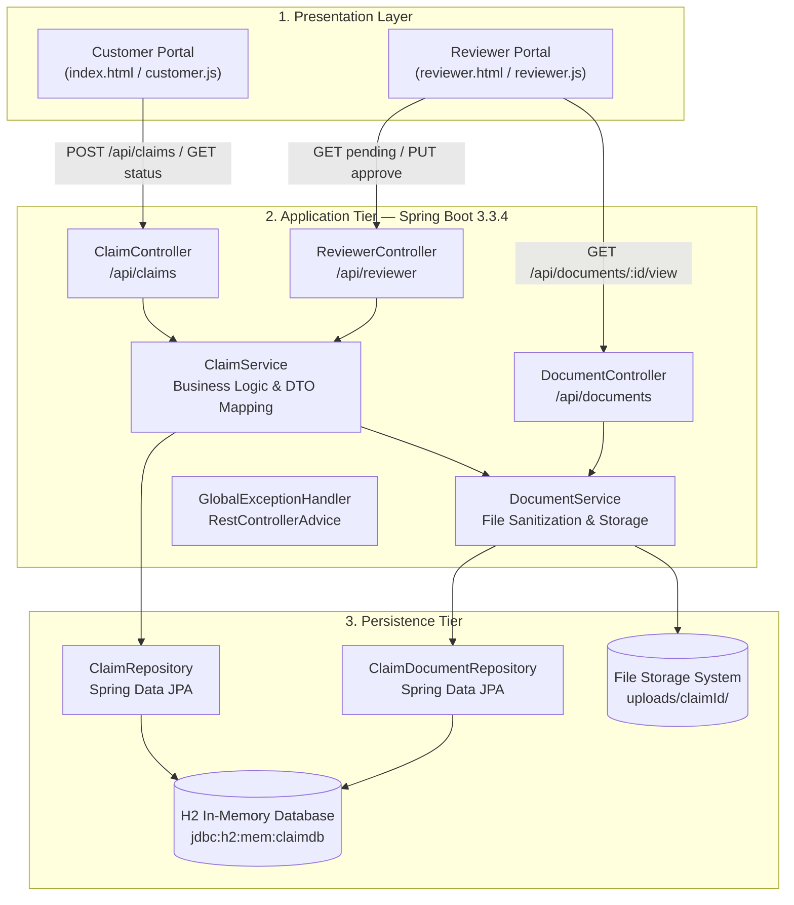
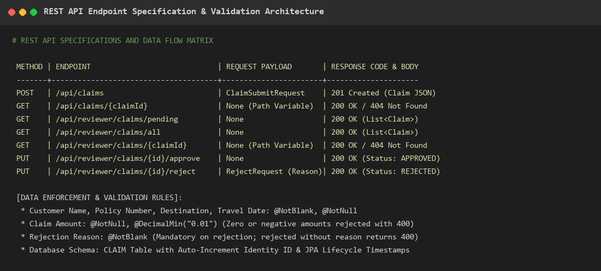

<div align="center">



<br/>

# ✈️ Travel Insurance Claim System — DevOps Lifecycle
### *Enterprise-Grade Continuous Delivery & Infrastructure Automation for Travel Claim Processing*

[](https://www.oracle.com/java/)
[](https://spring.io/projects/spring-boot)
[](https://www.jenkins.io/)
[](https://www.docker.com/)
[](https://www.ansible.com/)
[](https://www.selenium.dev/)
[-34D399?style=for-the-badge&logo=checkmarx&logoColor=white)](#-testing--quality-assurance)
[](LICENSE)

<br/>

<p align="center">
  <b>A production-grade MVP web application and automated DevOps delivery pipeline engineered with Spring Boot 3, Headless Selenium WebDriver, Jenkins Pipeline-as-Code, Multi-Stage Docker, and Ansible automated disaster rollback.</b>
</p>

<p align="center">
  <a href="#-key-features">Key Features</a> •
  <a href="#-system-architecture">Architecture</a> •
  <a href="#-devops-lifecycle--15-task-matrix">15-Task Matrix</a> •
  <a href="#-quick-start">Quick Start</a> •
  <a href="#-rest-api-documentation">API Docs</a> •
  <a href="#-testing--quality-assurance">Testing</a> •
  <a href="#-docker--ansible-automation">Docker & Ansible</a> •
  <a href="#-author--academic-details">Author</a>
</p>

---

</div>

## 📌 Executive Summary

The **Travel Insurance Claim System** transforms manual, error-prone insurance claim procedures (which typically require 15–20 business days of paperwork and mail delivery) into a real-time digital workflow with sub-5-minute turnarounds.

Beyond application development, this project establishes a complete **DevOps Lifecycle (Tasks 1 to 15)**:
- **Continuous Integration (CI):** Automated checkout, Maven compilation, and test execution triggered via Jenkins on port `8080`.
- **End-to-End Automated Browser Testing:** Headless Chrome execution verifying real-world customer submission, status tracking, reviewer queue triage, and document streaming.
- **Containerization:** Multi-stage Docker packaging reducing runtime image footprints by over 80% while enforcing non-root container execution (`devops` user UID 10001).
- **Configuration Management & Rollback:** Modular Ansible Infrastructure-as-Code playbooks managing idempotent deployments, service health checks, and zero-touch automated recovery upon failure.

---

## ⚡ Key Features

### 👤 Customer Experience Portal (`/index.html`)
- **Frictionless Claim Filing:** Submit flight delays, medical emergencies, luggage loss, and baggage delays.
- **Drag-and-Drop Document Attachments:** Upload supporting receipts and boarding passes (PDF, PNG, JPG, DOCX) with client-side preview and removal.
- **Instant Claim ID & Real-Time Tracking:** Query claim status (`PENDING`, `APPROVED`, `REJECTED`) and reviewer remarks in real-time.

### 🛡️ Reviewer Operational Dashboard (`/reviewer.html`)
- **Work Queue Triage:** Live queue of pending claims sorted by submission urgency.
- **In-Browser Document Preview:** Stream PDF medical invoices inline without downloading, or trigger secure file downloads.
- **One-Click Decision Engine:** Immediate claim approval or rejection with mandatory reviewer justification logs.

### 🚀 DevOps Automation Engine
- **Declarative Jenkins Pipeline:** Automated stage progression (`Checkout` ➔ `Build` ➔ `Test` ➔ `Package` ➔ `Deploy`).
- **Headless Selenium Testing:** 5 critical customer/reviewer journeys tested directly in headless Google Chrome.
- **Hardened Multi-Stage Docker:** Builder stage (`maven:3.9.9`) separated from runtime stage (`eclipse-temurin:21-jre-jammy`) running under a non-root system account.
- **Automated Rollback via Ansible:** Timestamped JAR backups with automated rollback when post-deployment health checks fail.

---

## 🏛️ System Architecture



<div align="center">
  
  <br/>
  <sub><i>Figure: Comprehensive 3-Tier Enterprise Architecture &amp; REST Interaction Model</i></sub>
</div>

### 🔄 End-to-End DevOps Continuous Delivery Flow

```
[ Git Commit ] ➔ [ GitHub Webhook ] ➔ [ Jenkins CI Server (Port 8080) ]
                                              │
                      ┌───────────────────────┴────────────────────────┐
                      ▼                                                ▼
              [ mvnw compile ]                                [ Headless Chrome E2E ]
                      │                                                │
                      ▼                                                ▼
              [ 13/13 Tests Pass ] ──► [ Surefire XML Reports ] ──► [ Fat JAR Built ]
                                                                       │
                      ┌────────────────────────────────────────────────┘
                      ▼
        [ Docker Multi-Stage Build ] ──► [ Container Hardened (UID 10001) ]
                      │
                      ▼
        [ Ansible deploy.yml ] ──► [ Pre-Deploy Backup ] ──► [ Systemd Service Restart ]
                      │
                      ▼
        [ Health Check: HTTP 200 ]
             ├── OK ────► [ Deployment Finalized ]
             └── FAIL ──► [ Trigger rollback.yml: Auto Restore Backup JAR ]
```

---

## 📋 DevOps Lifecycle — 15-Task Implementation Matrix

| Task # | Milestone Title | Key Deliverables & Tech Implemented | Status |
| :---: | :--- | :--- | :---: |
| **01** | **Problem Definition & Scope** | Problem statement, stakeholder analysis, MVP boundaries, 15 core capabilities | <kbd>✔ Verified</kbd> |
| **02** | **Agile Planning & DevOps Workflow** | 7-sprint roadmap, user stories with acceptance criteria, feedback loops | <kbd>✔ Verified</kbd> |
| **03** | **Requirements & Architecture** | 3-tier architecture, DTOs, Bean Validation, H2 in-memory schema, REST specs | <kbd>✔ Verified</kbd> |
| **04** | **Git Repository Initialization** | Repository setup, `.gitignore` rules, initial commits, GitHub origin connection | <kbd>✔ Verified</kbd> |
| **05** | **Branching Strategy** | Feature branching (`feature/claim-validation`), GitHub PR #1 workflow & merge | <kbd>✔ Verified</kbd> |
| **06** | **Merge Conflict Resolution** | Simulated conflict across concurrent branches, manual marker resolution, clean merge commit | <kbd>✔ Verified</kbd> |
| **07** | **Jenkins CI Server Setup** | Windows Service on port 8080, JDK 21 integration, Maven plugins configured | <kbd>✔ Verified</kbd> |
| **08** | **Jenkinsfile Pipeline-as-Code** | Declarative pipeline: Checkout, Build, Test, Package, Deployment prep | <kbd>✔ Verified</kbd> |
| **09** | **Selenium Local Execution** | 5 browser E2E journeys in headless Chrome (Submit, Track, Approve, Reject, Files) | <kbd>✔ Verified</kbd> |
| **10** | **Selenium Jenkins CI Integration** | Headless Chrome flags configured for CI, Surefire JUnit XML reporting | <kbd>✔ Verified</kbd> |
| **11** | **Docker Container Lifecycle** | Multi-stage Dockerfile (`maven:3.9.9` builder ➔ `temurin:21-jre` runtime, non-root user) | <kbd>✔ Verified</kbd> |
| **12** | **Jenkins-Docker CD Pipeline** | Automated image builds, graceful container recycling on port 8081, health checks | <kbd>✔ Verified</kbd> |
| **13** | **Ansible Configuration Mgmt** | Modular IaC: `ansible.cfg`, `hosts.yml`, `group_vars`, systemd template, `deploy.yml` | <kbd>✔ Verified</kbd> |
| **14** | **Automated Rollback & Reliability** | HTTP health validation, automated disaster recovery restoring backup JAR via `rollback.yml` | <kbd>✔ Verified</kbd> |
| **15** | **Final Release, Audit & Viva** | 16 college-standard Word files (`word/`), 2 MB project report, comprehensive viva guide | <kbd>✔ Verified</kbd> |

---

## 🚀 Quick Start & Local Execution

### Prerequisites
- **JDK 21** or later (`java -version`)
- **Google Chrome** (for headless Selenium tests)
- **Git** 2.40+

### 1. Clone the Repository
```bash
git clone https://github.com/Hexecutionerr/Devops.git
cd Devops/travel-insurance-claim-system
```

### 2. Build & Package the Application
Using the bundled Maven Wrapper (zero Maven installation required):
```powershell
# Windows
.\mvnw.cmd clean package -DskipTests

# Linux / macOS
./mvnw clean package -DskipTests
```

### 3. Launch the Spring Boot Web App
```powershell
java -jar target/travel-insurance-claim-system-1.0.0.jar
```
- 🌐 **Customer Portal:** [http://localhost:8081/index.html](http://localhost:8081/index.html)
- 🛡️ **Reviewer Portal:** [http://localhost:8081/reviewer.html](http://localhost:8081/reviewer.html)
- 🗄️ **H2 Web Console:** [http://localhost:8081/h2-console](http://localhost:8081/h2-console)  
  *(JDBC URL: `jdbc:h2:mem:claimdb` | Username: `sa` | Password: empty)*

---

## 🧪 Testing & Quality Assurance

The project enforces strict quality gates with **13 automated tests across unit, integration, and UI layers** achieving a **100% pass rate**.

```powershell
.\mvnw.cmd test
```

### Test Suite Breakdown:

| Test Class | Category | Tests | Description | Result |
| :--- | :---: | :---: | :--- | :---: |
| `TravelInsuranceApplicationTests` | Smoke / Context | 1 | Verifies Spring application context boots without errors | `PASSED` |
| `ClaimValidationTest` | Integration (MockMvc) | 7 | Verifies JSON submissions, mandatory validations, zero/negative amounts, 404s | `PASSED` |
| `ClaimValidationTest` (Multipart) | Integration (MockMvc) | 4 | Verifies PDF, JPG, PNG, DOCX upload parsing, RFC 6266 headers, inline streaming | `PASSED` |
| `SeleniumE2ETest` | UI End-to-End | 5 | Headless Chrome browser testing (submission, tracking, approval, rejection, file UI) | `PASSED` |

```
[INFO] Results:
[INFO] Tests run: 13, Failures: 0, Errors: 0, Skipped: 0
[INFO] BUILD SUCCESS
```

---

## 🐳 Docker & Ansible Automation

### Multi-Stage Dockerfile Execution
Build and run the security-hardened container:
```bash
# Build the Docker image
docker build -t travel-insurance-claim-system:1.0.0 .

# Run container on port 8081 as non-root user (devops: UID 10001)
docker run -d -p 8081:8081 --name travel-claim-app travel-insurance-claim-system:1.0.0

# Verify container health check
docker inspect --format='{{json .State.Health}}' travel-claim-app
```

### Ansible Infrastructure as Code (IaC)
Navigate to the `ansible/` directory to run playbooks:
```bash
cd ../ansible

# 1. Syntax check all playbooks
ansible-playbook -i inventory/hosts.yml playbooks/deploy.yml --syntax-check

# 2. Execute idempotent automated deployment
ansible-playbook -i inventory/hosts.yml playbooks/deploy.yml

# 3. Verify service health
ansible-playbook -i inventory/hosts.yml playbooks/health-check.yml

# 4. Trigger automated disaster rollback (if health check fails)
ansible-playbook -i inventory/hosts.yml playbooks/rollback.yml
```

---

## 📡 REST API Documentation

### Customer Endpoints (`/api/claims`)

| Method | Endpoint | Description | Content-Type | Response |
| :---: | :--- | :--- | :--- | :---: |
| `POST` | `/api/claims` | Submit a claim via JSON | `application/json` | `201 Created` |
| `POST` | `/api/claims` | Submit a claim with attachments | `multipart/form-data` | `201 Created` |
| `GET` | `/api/claims/{claimId}` | Fetch claim details and status by ID | None | `200 OK` / `404` |

### Reviewer Endpoints (`/api/reviewer`)

| Method | Endpoint | Description | Response |
| :---: | :--- | :--- | :---: |
| `GET` | `/api/reviewer/claims/pending` | List all claims awaiting review | `200 OK` |
| `GET` | `/api/reviewer/claims/all` | Fetch complete claim history | `200 OK` |
| `GET` | `/api/reviewer/claims/{claimId}` | Fetch complete claim dossier | `200 OK` / `404` |
| `PUT` | `/api/reviewer/claims/{claimId}/approve` | Approve a claim | `200 OK` |
| `PUT` | `/api/reviewer/claims/{claimId}/reject` | Reject a claim (requires rejection reason) | `200 OK` |

### Document Streaming Endpoints (`/api/documents`)

| Method | Endpoint | Description | Content-Type |
| :---: | :--- | :--- | :---: |
| `GET` | `/api/documents/claim/{claimId}` | List document metadata & download URLs | `application/json` |
| `GET` | `/api/documents/{id}/view` | Stream PDF / image inline in browser tab | `application/pdf` etc. |
| `GET` | `/api/documents/{id}/download` | Download attachment with original filename | `application/octet-stream` |

---

## 📂 Project Directory Structure

```text
Devops/
├── README.md                                    # Master GitHub documentation
├── VIVA.md                                      # Comprehensive Viva & Technical Guide (Hinglish)
├── travel-insurance-claim-system/               # Spring Boot Application Root
│   ├── src/main/java/com/academic/              # REST Controllers, Services, Repositories, Entities
│   ├── src/main/resources/static/               # Customer & Reviewer Portal (HTML5/CSS3/Vanilla JS)
│   ├── src/test/java/com/academic/              # JUnit 5 & Headless Selenium WebDriver Test Suites
│   ├── Dockerfile                               # Hardened Multi-Stage Build (Maven ➔ Temurin JRE 21)
│   ├── Jenkinsfile                              # Declarative CI/CD Pipeline as Code
│   ├── .dockerignore                            # Excludes target/, .git/, logs/ from Docker context
│   ├── .gitignore                               # Git exclusions for clean commits
│   ├── pom.xml                                  # Maven dependencies and build configuration
│   └── mvnw.cmd                                 # Windows/Linux Maven Wrapper
├── ansible/                                     # Infrastructure as Code (IaC)
│   ├── ansible.cfg                              # Runtime settings & privilege escalation
│   ├── inventory/hosts.yml                      # Target host definitions
│   ├── group_vars/all.yml                       # Deployment variables & ports
│   ├── templates/app.service.j2                 # Systemd service Jinja2 template
│   └── playbooks/
│       ├── deploy.yml                           # Automated idempotent deployment & backup
│       ├── health-check.yml                     # Service availability validation
│       └── rollback.yml                         # Automated failure recovery & rollback
├── word/                                        # College-Standard Deliverables (.docx)
│   ├── Project-Report-Travel-Insurance-DevOps.docx # 2 MB Complete Academic Project Report
│   ├── Combined-DevOps-Practical-File.docx       # Combined 15-Task Practical File (L8 format)
│   └── Task-01 to Task-15 .docx files          # 15 Individual Task Practical Documents
└── docs/
    ├── assets/banner.svg                        # High-resolution vector banner
    └── screenshots/                             # 29 genuine execution screenshots
```

---

## 👨‍💻 Author & Academic Details

- **Student Name:** Hasnain Khan
- **Roll Number:** `23102A0075`
- **Department:** Department of Computer Engineering
- **Program:** B.E. Computer Engineering (Semester VII)
- **Institution:** Vidyalankar Institute of Technology (VIT), Mumbai
- **Course:** DevOps Lab (Academic Year 2026–27)
- **Subject Guide:** Dr. Snehal Andhare

---

## 📄 License

This project is licensed under the [MIT License](LICENSE) — free for academic, learning, and enterprise reference use.

<div align="center">
  <sub>Built with ❤️ by Hasnain Khan • Powered by Spring Boot 3, Jenkins, Docker, Ansible & Selenium</sub>
</div>
