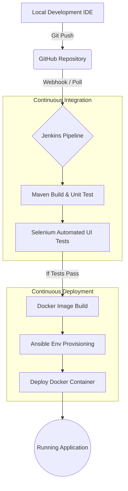

# TASK 2: Agile Planning and DevOps Workflow

## 1. User Stories

### Customer
- **US1:** As a customer, I want to submit a new travel insurance claim with my travel and incident details, so that I can request compensation for my travel disruption.
- **US2:** As a customer, I want to view my submitted claim details, so that I can verify the information I provided.
- **US3:** As a customer, I want to track the current status of my claim, so that I know whether it is pending, approved, or rejected.

### Reviewer
- **US4:** As a reviewer, I want to view a list of all pending claims, so that I can prioritize and organize my daily workload.
- **US5:** As a reviewer, I want to open a specific claim and review its details, so that I can make an informed decision on whether it meets the policy criteria.
- **US6:** As a reviewer, I want to approve or reject a claim, optionally providing a reason, so that the customer's request is resolved.

### System/DevOps (Technical Stories)
- **US7:** As a system administrator, I want mandatory fields to be validated upon submission, so that incomplete or invalid claims do not enter the database.
- **US8:** As a DevOps engineer, I want the application source code to be automatically built and tested upon commit, so that I can detect integration errors early.
- **US9:** As a DevOps engineer, I want the application to be packaged into a Docker container, so that it runs consistently across different environments.
- **US10:** As a DevOps engineer, I want the deployment environment to be provisioned and configured using Ansible, so that the deployment process is reproducible and automated.

## 2. Acceptance Criteria

| User Story | Acceptance Criteria |
| :--- | :--- |
| **US1 (Submit Claim)** | 1. User can access the claim submission form. 2. Form requires mandatory fields (e.g., Name, Policy Number, Claim Amount). 3. Upon successful submission, a unique Claim ID is generated and displayed. |
| **US2 (View Claim)** | 1. User can input their Claim ID to retrieve their claim. 2. The displayed information matches the submitted data exactly. |
| **US3 (Track Status)** | 1. The status clearly displays as Pending, Approved, or Rejected. 2. If rejected, the rejection reason (if provided) is visible. |
| **US4 (View Pending Claims)**| 1. Reviewer dashboard displays a list of all claims with "Pending" status. 2. List includes basic info (Claim ID, Date, Amount) for quick scanning. |
| **US5 (Review Details)** | 1. Clicking a claim opens the full submission details. 2. Document reference IDs and incident descriptions are visible. |
| **US6 (Approve/Reject)** | 1. Reviewer can click "Approve" or "Reject". 2. If "Reject" is selected, a text field for reason becomes available. 3. Database state updates immediately upon decision. |
| **US7 (Validation)** | 1. Submitting with an empty mandatory field prevents submission and shows an error. 2. Submitting a non-numerical value in the amount field shows an error. |

## 3. Product Backlog

| Backlog ID | User Story / Task | Priority | Description | Acceptance Criteria Summary |
| :--- | :--- | :--- | :--- | :--- |
| **PB1** | US1: Submit Claim | High | Form allowing customers to input claim details. | Form accessible, validates data, generates Claim ID. |
| **PB2** | US7: Validation Logic | High | Backend/Frontend validation for required data and formats. | Empty fields blocked, invalid formats rejected. |
| **PB3** | US4: View Pending Claims | High | Reviewer dashboard to list claims awaiting action. | List of pending claims visible to reviewers. |
| **PB4** | US5: Review Details | High | View detailed claim page for reviewers. | All submitted claim data is readable. |
| **PB5** | US6: Approve/Reject | High | Action buttons to finalize claim state. | Claim status updates; optional rejection reason saved. |
| **PB6** | US3: Track Status | Medium | Customer portal to check the decision on their claim. | Displays Pending/Approved/Rejected accurately. |
| **PB7** | US2: View Claim | Medium | Customer portal to see their full submitted data. | Claim data retrieved securely by ID. |
| **PB8** | US8: CI Pipeline | High | Jenkins job to compile code and run Unit/Selenium tests. | Code builds successfully; tests pass. |
| **PB9** | US9: Containerization | High | Dockerfile creation and image build process. | App runs inside an isolated Docker container. |
| **PB10** | US10: Env Provisioning | High | Ansible playbook to set up server dependencies and deploy. | Server configured and app deployed without manual steps. |

*(Note: This backlog focuses on MVP application capabilities and their technical implementation for an academic scope.)*

## 4. 15-Task Kanban/Scrum Plan

This plan maps the 15 instructor-assigned implementation tasks into a logical workflow.

| Task ID | Task Name | Short Objective | Dependencies | Expected Output | Status |
| :--- | :--- | :--- | :--- | :--- | :--- |
| **Task 1** | Problem Definition and Scope | Define MVP requirements and constraints. | None | Scope Document (TASK-01) | Done |
| **Task 2** | Agile Planning and DevOps Workflow | Create user stories, backlog, and DevOps plan. | Task 1 | Planning Document (TASK-02) | Done |
| **Task 3** | Requirements, Architecture and Technology Setup | Install IDEs and define tech stack (Java, Spring Boot, etc.). | Task 2 | Tech Stack definition, Architecture diagram | Done |
| **Task 4** | Git and GitHub Repository Initialization | Set up version control and repository structure. | Task 3 | GitHub Repo initialized | Done |
| **Task 5** | Feature Development with Branching | Develop application MVP features using Git branches. | Task 4 | Source code for application capabilities | Done |
| **Task 6** | MVP Completion and Git Collaboration | Merge branches and finalize the core application. | Task 5 | Functional MVP codebase in `main` branch | Done |
| **Task 7** | Jenkins Installation and Continuous Integration Job | Install Jenkins and create a basic build job. | Task 6 | Jenkins CI job configured | Done |
| **Task 8** | Pipeline as Code and Server Deployment | Convert job to Jenkinsfile and deploy to a local server. | Task 7 | Jenkinsfile in repo, automated build | Done |
| **Task 9** | Selenium Test Design and Local Execution | Write automated UI tests for critical user journeys. | Task 6 | Selenium test scripts | Done |
| **Task 10**| Continuous Testing in Jenkins | Integrate Selenium tests into the Jenkins pipeline. | Task 8, Task 9 | Jenkins pipeline executing UI tests | Done |
| **Task 11**| Docker Image and Container Lifecycle | Write Dockerfile and build application image. | Task 6 | Dockerfile, Docker image | Done |
| **Task 12**| Jenkins-Docker Continuous Deployment | Automate Docker image creation and deployment via Jenkins. | Task 10, Task 11 | Pipeline deploying Docker containers | To Do |
| **Task 13**| Configuration Management Script | Write Ansible playbooks for server configuration. | Task 12 | Ansible Playbooks | To Do |
| **Task 14**| Automated Provisioning and Reliability Validation | Integrate Ansible into Jenkins for full deployment and test rollback. | Task 13 | End-to-end Pipeline, Rollback verified | To Do |
| **Task 15**| Final End-to-End Release, Documentation and Viva | Final review, documentation generation, and viva preparation. | Task 14 | Final project report, presentation | To Do |

## 5. Definition of Done

For this individual academic project, a task or user story is considered "Done" when:
- **Implementation completed:** All required functionality for the story/task is written.
- **Code works:** The feature runs locally without crashing.
- **Testing completed:** Relevant unit or Selenium tests have passed successfully.
- **No known critical errors:** The code contains no major bugs or security flaws relevant to the MVP scope.
- **Git changes committed:** Code is committed, pushed to the GitHub repository, and merged into the main branch.
- **Documentation updated:** Relevant markdown files or inline code comments are updated.
- **Required evidence captured:** Screenshots of successful builds, test passes, or running containers are captured if required for academic submission.
- **Instructor task deliverable satisfied:** The specific objective of the instructor's numbered task is fully met.

## 6. DevOps Lifecycle

1. **Plan:** Requirements and MVP scope are finalized. User stories and tasks are tracked in the backlog.
2. **Develop:** The student writes Java/Spring Boot code and Selenium tests locally using an IDE.
3. **Git/GitHub:** Code is committed and pushed to the remote repository. This triggers the automated pipeline.
4. **Jenkins CI:** Jenkins detects the change and initiates the Continuous Integration pipeline.
5. **Build:** Maven compiles the source code, resolves dependencies, and runs unit tests.
6. **Selenium Testing:** Automated UI tests execute against the built application to verify critical user journeys (e.g., Claim Submission).
7. **Docker Build:** The application artifact is packaged into a standardized Docker image.
8. **Docker Registry:** The Docker image is stored or cached for deployment.
9. **Ansible Provisioning:** Ansible playbooks ensure the target environment (e.g., local server/VM) is properly configured with required dependencies (Java, Docker daemon).
10. **Deployment:** The application container is started on the provisioned environment.
11. **Health Check:** Automated checks confirm the application is running and accessible on the expected port.
12. **Monitor/Operate:** The student monitors the running application logs for errors during the demonstration phase.
13. **Feedback:** Issues found during testing or monitoring are fed back into the 'Plan' phase as new backlog items.

## 7. DevOps Workflow Diagram

