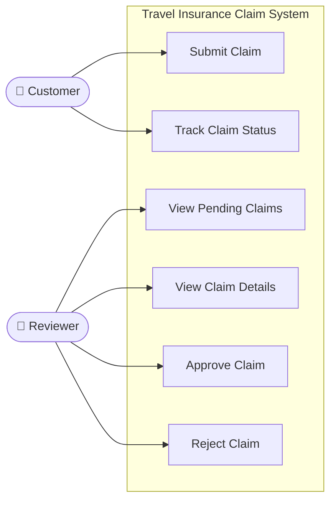
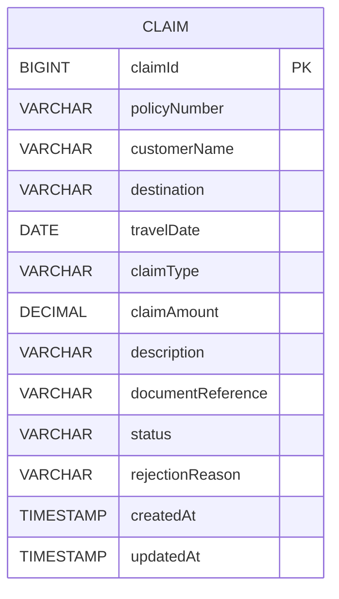

# TASK 3: Requirements, Architecture and Technology Setup

## 1. SRS Summary (Software Requirements Specification)

This document defines the functional requirements, architecture, technology stack, and data model for the Travel Insurance Claim System MVP. The application is a Spring Boot-based web application allowing customers to submit and track travel insurance claims, and reviewers to approve or reject those claims. It is designed for academic demonstration purposes only.

## 2. Functional Requirements

| ID | Requirement |
| :--- | :--- |
| **FR1** | The system shall allow a customer to submit a new travel insurance claim by providing all required fields. |
| **FR2** | The system shall validate all mandatory fields during claim submission and return descriptive error messages for missing or invalid data. |
| **FR3** | The system shall generate and return a unique Claim ID upon successful submission. |
| **FR4** | The system shall set the initial status of every submitted claim to `PENDING`. |
| **FR5** | The system shall allow a customer to retrieve the full details and current status of a claim by providing its Claim ID. |
| **FR6** | The system shall allow a reviewer to view a list of all claims with `PENDING` status. |
| **FR7** | The system shall allow a reviewer to view the full details of any specific claim. |
| **FR8** | The system shall allow a reviewer to approve a `PENDING` claim, updating its status to `APPROVED`. |
| **FR9** | The system shall allow a reviewer to reject a `PENDING` claim with a mandatory rejection reason, updating its status to `REJECTED`. |
| **FR10** | The system shall persist all claim data in a relational database. |

## 3. Non-Functional Requirements

| ID | Requirement |
| :--- | :--- |
| **NFR1** | The application shall start and run on a single machine using embedded Tomcat (no external server setup required). |
| **NFR2** | The REST API shall return appropriate HTTP status codes (201, 200, 400, 404). |
| **NFR3** | The application shall use an H2 in-memory database for local development and demonstration. |
| **NFR4** | The frontend shall be functional HTML/CSS/JavaScript without requiring a separate Node.js server. |
| **NFR5** | The codebase shall follow a clean layered architecture (Controller → Service → Repository → Entity). |
| **NFR6** | The application is an academic MVP and does not require production-grade authentication, authorization, or security hardening. |

## 4. Actors

| Actor | Description |
| :--- | :--- |
| **Customer** | Submits claims and tracks their status via the Customer Portal (`index.html`). |
| **Reviewer** | Views pending claims, inspects details, and makes approve/reject decisions via the Reviewer Portal (`reviewer.html`). |
| **System** | The backend that validates data, persists claims, enforces status rules, and responds to API requests. |

## 5. Use Cases

| Use Case ID | Actor | Use Case Name | Description |
| :--- | :--- | :--- | :--- |
| **UC1** | Customer | Submit Claim | Customer fills the form, system validates, stores claim, returns Claim ID. |
| **UC2** | Customer | View Claim Status | Customer enters Claim ID, system returns current status and claim details. |
| **UC3** | Reviewer | View Pending Claims | Reviewer loads a list of all claims with PENDING status. |
| **UC4** | Reviewer | Review Claim Details | Reviewer selects a specific claim to view all submitted information. |
| **UC5** | Reviewer | Approve Claim | Reviewer clicks Approve; system sets status to APPROVED. |
| **UC6** | Reviewer | Reject Claim | Reviewer provides a reason and clicks Reject; system sets status to REJECTED. |

## 6. Use-Case Diagram



## 7. System Architecture

The application follows a standard three-tier web architecture:

1. **Presentation Tier:** Static HTML, CSS, and Vanilla JavaScript files served by embedded Tomcat. JavaScript uses the `fetch` API to call the backend REST endpoints.
2. **Application Tier (Spring Boot):** REST Controllers receive requests, delegate business logic to a Service layer, which in turn uses a Repository to interact with the database. Bean Validation enforces input rules.
3. **Data Tier (H2):** An H2 in-memory relational database stores all claim data. JPA/Hibernate handles the Object-Relational Mapping (ORM).

## 8. Architecture Diagram

```mermaid
graph TD
    Browser["🌐 Browser\n(index.html / reviewer.html)"]

    subgraph "Spring Boot Application (Port 8080)"
        direction TB
        StaticFiles["Static Files\n(style.css, customer.js, reviewer.js)"]
        CC["ClaimController\n(POST /api/claims, GET /api/claims/{id})"]
        RC["ReviewerController\n(GET /api/reviewer/claims/pending,\nGET /api/reviewer/claims/{id},\nPUT approve/reject)"]
        CS["ClaimService\n(Business Logic, Validation)"]
        CR["ClaimRepository\n(JPA Data Access)"]
    end

    DB[("H2 In-Memory Database\n(CLAIM table)")]

    Browser -->|HTTP GET| StaticFiles
    Browser -->|REST API calls (fetch)| CC
    Browser -->|REST API calls (fetch)| RC
    CC --> CS
    RC --> CS
    CS --> CR
    CR -->|JPA/Hibernate| DB
```

## 9. Technology Stack and Justification

| Technology | Version | Role | Justification |
| :--- | :--- | :--- | :--- |
| **Java** | 25 (JRE), 21 (bytecode target) | Runtime Language | Java 25 is the current LTS-adjacent release installed. Compiled to Java 21 bytecode for Spring Boot 3.3.4 ASM compatibility. |
| **Spring Boot** | 3.3.4 | Application Framework | Auto-configures Tomcat, JPA, and Validation; simplifies REST API development significantly. |
| **Maven** | 3.9.9 (via wrapper) | Build Tool | Industry-standard Java build tool; manages dependencies, compilation, and packaging. |
| **Spring Web** | (via Spring Boot) | REST API + Web Server | Provides the REST controller model and embedded Tomcat server. No external server required. |
| **Spring Data JPA** | (via Spring Boot) | Database Access | Provides repository interfaces; eliminates boilerplate SQL. Hibernate is the underlying ORM. |
| **Bean Validation** | (via Spring Boot) | Input Validation | Annotation-based field validation (`@NotBlank`, `@NotNull`, `@DecimalMin`) without manual checks. |
| **H2 Database** | (via Spring Boot) | Local Database | In-memory relational database; no external database installation required for local development. |
| **HTML/CSS/JS** | Standard | Frontend UI | Vanilla implementation requires no Node.js, npm, or build tools for the frontend. |
| **Embedded Tomcat** | (via Spring Boot) | Web Server | Eliminates need for a separately installed server; application is self-contained. |

## 10. Data Model

The single entity is the `Claim`, stored in the `CLAIM` table in H2.

| Field | Type | Constraints | Description |
| :--- | :--- | :--- | :--- |
| `claimId` | `BIGINT` | PK, Auto-Generated | Unique identifier for each claim. |
| `policyNumber` | `VARCHAR` | NOT NULL | Customer's insurance policy number. |
| `customerName` | `VARCHAR` | NOT NULL | Full name of the claimant. |
| `destination` | `VARCHAR` | NOT NULL | Travel destination where the incident occurred. |
| `travelDate` | `DATE` | NOT NULL | Date of travel/incident. |
| `claimType` | `VARCHAR` | NOT NULL | Category of claim (e.g., Flight Cancellation). |
| `claimAmount` | `DECIMAL` | NOT NULL, > 0 | Amount claimed by the customer. |
| `description` | `VARCHAR(1000)` | NOT NULL | Description of the incident. |
| `documentReference` | `VARCHAR` | NOT NULL | Text reference to supporting documents (e.g., receipt number). Not a file upload. |
| `status` | `VARCHAR` (Enum) | NOT NULL, Default: PENDING | Current state: `PENDING`, `APPROVED`, or `REJECTED`. |
| `rejectionReason` | `VARCHAR(500)` | Nullable | Reviewer's reason; only set when status is `REJECTED`. |
| `createdAt` | `TIMESTAMP` | NOT NULL, Set on insert | Timestamp of initial claim submission. |
| `updatedAt` | `TIMESTAMP` | NOT NULL, Updated on save | Timestamp of the last modification. |

## 11. Entity-Relationship Diagram



*(Note: The MVP contains a single entity. No multi-table relationships are required for this scope.)*

## 12. REST API Reference

| # | Method | Endpoint | Purpose | Request Body | Response |
| :-- | :--- | :--- | :--- | :--- | :--- |
| 1 | `POST` | `/api/claims` | Submit a new claim | `ClaimSubmitRequest` JSON | `201 Created` — Full `Claim` object with generated `claimId` |
| 2 | `GET` | `/api/claims/{claimId}` | Get claim by ID (customer) | None | `200 OK` — Full `Claim` object; `404` if not found |
| 3 | `GET` | `/api/reviewer/claims/pending` | Get all pending claims | None | `200 OK` — Array of `Claim` objects |
| 4 | `GET` | `/api/reviewer/claims/{claimId}` | Get specific claim for review | None | `200 OK` — Full `Claim` object; `404` if not found |
| 5 | `PUT` | `/api/reviewer/claims/{claimId}/approve` | Approve a claim | None | `200 OK` — Updated `Claim` (status: `APPROVED`) |
| 6 | `PUT` | `/api/reviewer/claims/{claimId}/reject` | Reject a claim | `{ "rejectionReason": "..." }` | `200 OK` — Updated `Claim` (status: `REJECTED`) |

**Validation Errors:** Returns `400 Bad Request` with a JSON body containing `fieldErrors` map.
**Not Found:** Returns `404 Not Found` with a descriptive `message`.

## 13. Local Setup Instructions

### Prerequisites
- Java JDK 21 or above installed (Java 25 confirmed working).
- An internet connection (only needed for the first Maven run to download dependencies).
- No external database, no Docker, no additional servers required.

### Steps
1. Clone or download the project into the `travel-insurance-claim-system` folder.
2. Open a terminal (Command Prompt or PowerShell) in that folder.
3. Verify Java is working: `java -version`

## 14. How to Run the Application

**Using the IntelliJ Maven (if IntelliJ is installed):**
```powershell
$env:JAVA_HOME = "C:\Program Files\Java\jdk-25"
$mvn = "C:\Program Files\JetBrains\IntelliJ IDEA 2025.3.1\plugins\maven\lib\maven3\bin\mvn.cmd"
& $mvn spring-boot:run
```

**Using the Maven Wrapper (once it downloads itself):**
```powershell
$env:JAVA_HOME = "C:\Program Files\Java\jdk-25"
.\mvnw.cmd spring-boot:run
```

The first run will download Spring Boot dependencies from Maven Central (~50–100 MB). Subsequent runs are fast.

**Expected startup log:**
```
Started TravelInsuranceApplication in ~3-5 seconds
Tomcat started on port 8080
```

## 15. How to Verify the Application

After starting, open a browser and visit:

| Resource | URL |
| :--- | :--- |
| **Customer Portal** | http://localhost:8080 |
| **Reviewer Portal** | http://localhost:8080/reviewer.html |
| **H2 Database Console** | http://localhost:8080/h2-console |

**H2 Console JDBC URL:** `jdbc:h2:mem:claimdb` | Username: `sa` | Password: *(leave blank)*

**Manual verification steps:**
1. Go to the Customer Portal → fill the claim form → click **Submit Claim** → note the generated Claim ID.
2. Go to the **Track Claim** tab → enter the Claim ID → verify all fields appear correctly with status `PENDING`.
3. Go to the Reviewer Portal → click **Refresh List** → verify the claim appears.
4. Click the claim → click **Approve** or **Reject** (with a reason) → verify the status changes.
5. Return to the Customer Portal → search the same Claim ID → verify the updated status and rejection reason are visible.

## 16. Task 3 Acceptance Checklist

- [x] **AR1:** Spring Boot project created with correct Maven structure.
- [x] **AR2:** All required Java classes created (Entity, Repository, Service, Controllers, DTOs, Exception handlers).
- [x] **AR3:** H2 database configured in `application.properties`.
- [x] **AR4:** All 6 REST API endpoints implemented and functional.
- [x] **AR5:** Bean Validation applied to all input DTOs.
- [x] **AR6:** `ClaimStatus` enum enforces valid state transitions.
- [x] **AR7:** `documentReference` field stores text reference only — no file upload implemented (per MVP scope).
- [x] **AR8:** Customer Portal HTML/JS (`index.html`, `customer.js`) implemented and functional.
- [x] **AR9:** Reviewer Portal HTML/JS (`reviewer.html`, `reviewer.js`) implemented and functional.
- [x] **AR10:** Global exception handler returns structured JSON error responses.
- [x] **AR11:** `mvn clean test` passes — `Tests run: 1, Failures: 0, Errors: 0, Skipped: 0`.
- [x] **AR12:** Technology stack consistent with Task 1 and Task 2 documentation.
- [x] **AR13:** No authentication, payment gateway, OCR, AI features, or file upload implemented.
